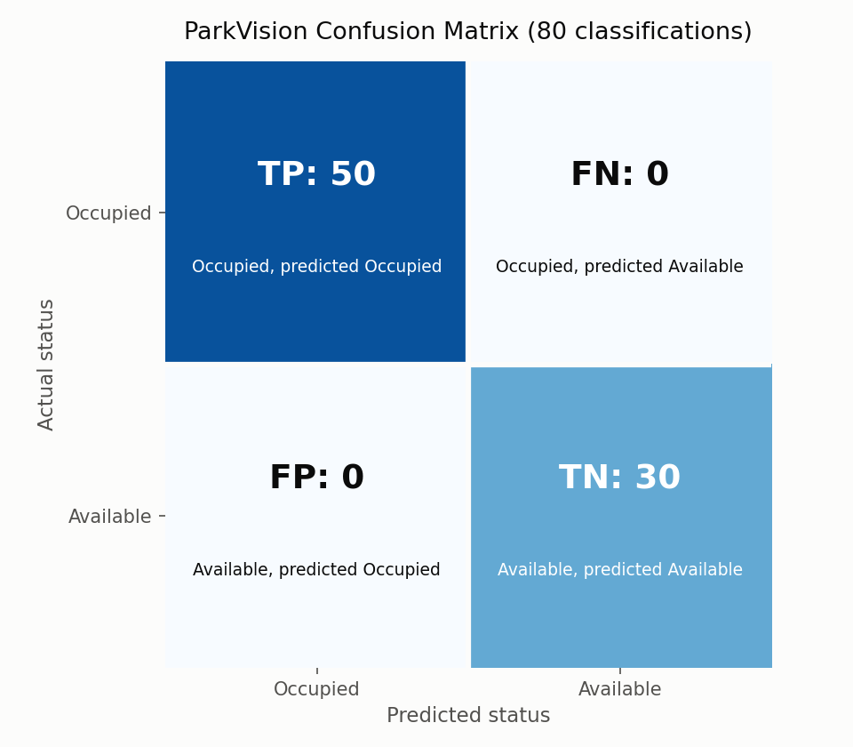
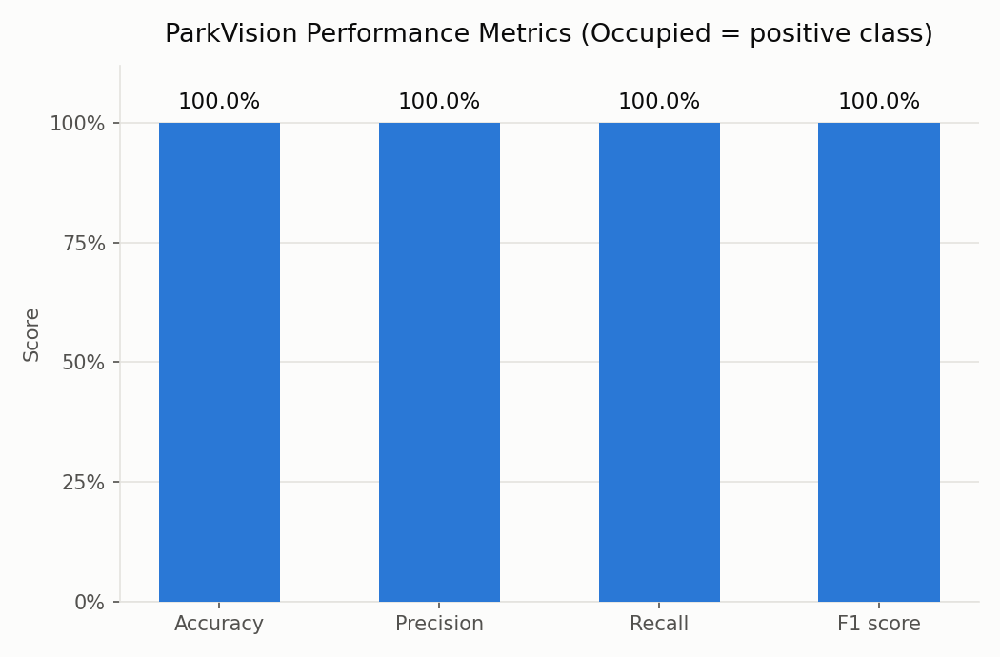
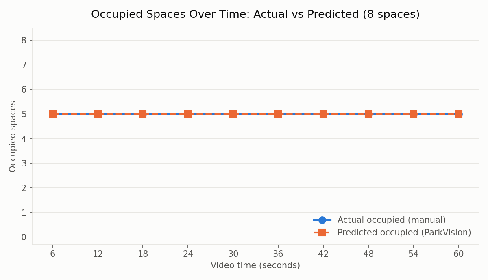
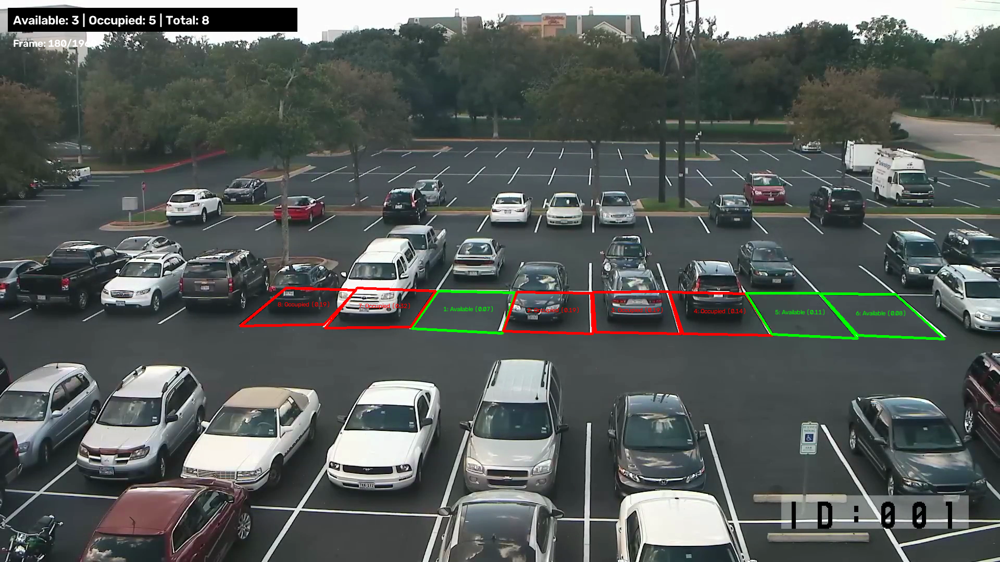
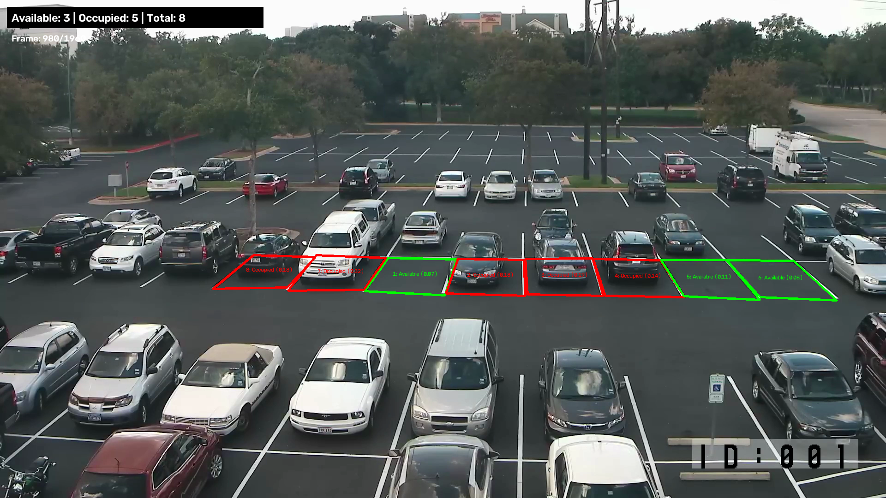
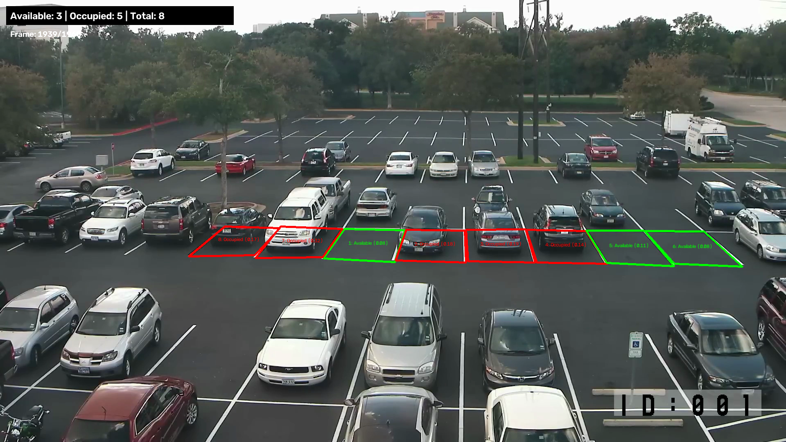

# ParkVision Evaluation

## Evaluation Method

For each sampled frame, each parking space was classified manually. Looking at the original, unannotated frames from the video, each space was classified as either Occupied or Available. This manual classification is stored in `results/evaluation_results.csv` as `actual_status`, alongside the detector's prediction for the same space and frame, stored as `predicted_status`.

The detector classifies each space based on two features measured inside the space boundary: edge density (the proportion of pixels found to be edges by Canny edge detection) and contrast (the standard deviation of grayscale intensities). When a car is present in a space, both values are higher. A score is calculated as edge density + 0.75 × normalized contrast. If this score is greater than or equal to 0.14, the space is classified as occupied.

To make classifications more stable across frames, the score is averaged over time using an exponential moving average (smoothing factor 0.20). Hysteresis is also used to prevent false changes in classification: once a space is classified as occupied, it is only reclassified as available when its score falls clearly below the threshold, by at least 0.02 (below 0.12).

Predictions were generated with `src/collect_predictions.py`, which applies the same scoring, smoothing, and hysteresis as `src/main.py` to every frame of the video and stores the prediction at each sampled time. Metrics were then calculated from the results with `src/evaluate.py`. Occupied is treated as the positive class:

- **True positive (TP):** occupied and predicted occupied
- **True negative (TN):** available and predicted available
- **False positive (FP):** available but predicted occupied
- **False negative (FN):** occupied but predicted available

The metrics are calculated as:

- Accuracy = (TP + TN) / total
- Precision = TP / (TP + FP)
- Recall = TP / (TP + FN)
- F1 = 2 / (1/Precision + 1/Recall)

## Dataset and Sampling

- **Video:** `primary_parking.mp4` (1920 × 1080), about 65 seconds long (1,960 frames) at 30.03 frames per second.
- **Spaces:** 8 clearly visible spaces. Space boundaries are defined in `spaces.json`.
- **Sampled frames:** 10 samples taken at approximately 6, 12, 18, 24, 30, 36, 42, 48, 54, and 60 seconds. Because the frame rate is 30.03 fps, each frame number is the time multiplied by the frame rate; for example, 18 seconds corresponds to frame 541.
- **Total classifications:** 10 frames × 8 spaces = 80.

In all sampled frames, 5 spaces were occupied and 3 were available. Spaces in the rear of the parking lot were not assessed, because vehicles in the foreground blocked the view of those spaces. As a result, the true status of those spaces could not be reliably determined either manually or by the algorithm.

## Results

| Metric | Value |
|---|---|
| Total classifications | 80 |
| Correct classifications | 80 |
| Accuracy | 100% |
| True positives (TP) | 50 |
| True negatives (TN) | 30 |
| False positives (FP) | 0 |
| False negatives (FN) | 0 |
| Precision | 100% |
| Recall | 100% |
| F1 score | 100% |
| Processing speed (`src/main.py`) | ≈14.6 fps (1,960 frames in 133.9 s) |

All 80 classifications were correct, with no false positives or false negatives. At each sampled time, the detector identified 5 of the 8 spaces as occupied, matching the manual classification. However, this result should be interpreted carefully: no vehicles entered or left any of the 8 spaces between 6 and 60 seconds. The 80 classifications are therefore the same 8 classifications repeated, and they do not show how quickly or accurately the detector responds to changes in occupancy.

Processing speed was measured by running `src/main.py` on the full video on a MacBook: 1,960 frames took 133.9 seconds, about 14.6 frames per second. Because this time includes drawing and displaying the overlay, it is a conservative measure.

## Observed Errors

There were no errors in the 80 classifications. However, two observations show where the method is fragile:

- **The threshold margin is very small.** Scores for occupied spaces ranged from about 0.14 to 0.32, and scores for available spaces ranged from about 0.07 to 0.11. Space 4, which holds a dark vehicle, scored about 0.14, right at the threshold. Available space 5 scored about 0.11, only 0.03 below it. Space 4 stayed classified as occupied, and hysteresis would keep it occupied unless its score dropped below 0.12. A slightly darker vehicle, a shadow, or a change in lighting could cause space 4 to be misclassified as available, and a shadow or other added texture could push empty space 5 above the threshold and cause it to be misclassified as occupied.
- **Passing vehicle.** Around 48 and 54 seconds, a white vehicle drove along the aisle and briefly passed in front of spaces 7 and 8, covering their front edges. Because those spaces were already occupied, this did not cause an error. However, a vehicle passing in front of an available space could temporarily raise its score and cause it to be misclassified as occupied. Because scores are smoothed over time, this is less likely to happen.

## Limitations

- **Shadows:** a shadow from a vehicle, tree, or structure falling on an available space can create extra edges and brightness variation, raising its score high enough to be classified as occupied.
- **Lighting changes:** because the threshold is fixed, changes in lighting (sunlight, cloud cover, and time of day) can shift the scores of both available and occupied spaces.
- **Camera angle:** with a low camera angle, parts of cars can extend outside their own space boundaries and overlap neighboring spaces.
- **Vehicle color:** darker or low-contrast cars produce fewer edges and less brightness variation, making them harder to detect. In this test, the dark vehicle in space 4 scored right at the threshold.
- **Occlusion:** spaces hidden behind foreground vehicles cannot be classified, so the spaces in the rear of the parking lot were excluded from the evaluation.
- **Manual space boundaries:** space boundaries were drawn by hand for one camera position. If the camera moves, or a boundary is slightly off, results can degrade, and the setup must be repeated for every new parking lot.
- **Limited sample size:** only 80 classifications were made from one 65-second video. None of the 8 spaces changed occupancy during the sampled period, so the result does not show how well the detector handles cars arriving or leaving. It may also not be representative of other parking lots, weather, or times of day.
- **Lag:** smoothing and hysteresis make classifications more stable, but they also cause a short delay between a car arriving or leaving and the classification updating.

## Future Improvements

- **Higher camera:** a higher camera position would reduce occlusion and overlap between neighboring spaces.
- **Multiple cameras:** cameras at different angles would allow spaces blocked in one view to be classified from another.
- **Automatic space detection:** detecting space boundaries automatically from the painted lines would remove the need to draw boundaries by hand and make setup in new parking lots much faster.
- **Trained detection model:** a vehicle detection model such as YOLO, trained on parking lot images, would be less sensitive to shadows, lighting, and vehicle color than hand-designed features.
- **Adaptive threshold:** a threshold that adapts to current lighting, or a separate threshold for each space, would reduce errors caused by lighting changes.
- **Larger sample:** labeling more frames, videos, and lighting conditions, including videos with cars arriving and leaving, would give a better measure of both accuracy and response time.
